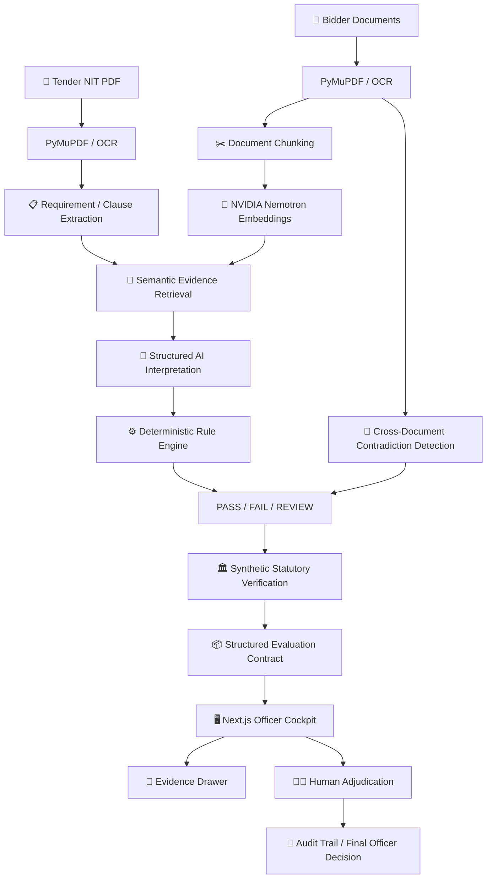

# 🛡️ BidGuard AI
**AI-Powered Integrated Bid Compliance Verification Platform for GeM Procurement**

<p align="center">
  <strong>Smart India Hackathon 2026</strong><br>
  <strong>Problem Statement: SIH26100</strong> · <strong>Theme: Smart Automation</strong> · <strong>Category: Software</strong>
</p>

<p align="center">
  <a href="https://github.com/harshilsetty/sih26100-bidguard">
    
  </a>
  
  
  
</p>

<p align="center">
  <em>AI assists. Evidence explains. Rules verify. Humans decide.</em>
</p>

---

## 📌 Prototype Notice

BidGuard AI is an SIH 2026 prototype / sandbox demonstration.

- Demonstration tender records, bidder submissions, and statutory registry records are **synthetic** or anonymized public-domain specimens.
- The prototype does **not** claim access to confidential government procurement records.
- It does **not** claim live production connectivity to GeM, GSTN, MCA21, CBDT, or other restricted government systems.
- Statutory verification shown in the prototype uses **simulated/synthetic adapters**.
- The system provides **decision support**; the final procurement decision remains with the authorized human officer.

---

## 🎯 What is BidGuard AI?

BidGuard AI is an evidence-backed procurement compliance decision-support platform designed to help officers review tender requirements and bidder submissions systematically.

It combines:

- 📄 **Document extraction** for tender and bidder PDFs
- 🧠 **Semantic retrieval** to locate relevant evidence
- 🔎 **Evidence grounding** with document and page provenance
- ⚙️ **Deterministic rules** for numeric and threshold validation
- ⚠️ **Contradiction detection** across bidder documents
- 🏛️ **Synthetic statutory verification adapters**
- 👨‍⚖️ **Human-in-the-loop adjudication**
- 📊 **Compliance dashboards** and audit-oriented results

The central design principle is simple:

> Don't ask AI to decide whether a bidder is compliant. Ask AI to **find the evidence**, verify it with **deterministic rules**, and **show the officer why** the result was produced.

---

## 🧩 Problem Statement

Public procurement evaluation can involve large tender notices, technical brochures, financial statements, certificates, declarations, and statutory documents.

The review process becomes difficult when officers must:

- 🔍 Find the relevant clause inside lengthy documents.
- 📑 Locate the corresponding bidder evidence.
- 🧮 Compare numerical values against mandatory thresholds.
- 🔄 Cross-check claims across multiple bidder documents.
- 🏛️ Verify statutory information from multiple sources.
- 📝 Preserve enough evidence for an auditable decision.
- 👨‍⚖️ Handle ambiguous or contradictory evidence without blindly trusting automation.

**The key problem**

A generic LLM response such as:

> "The bidder appears compliant."

is not sufficient for a high-stakes procurement workflow.

BidGuard AI therefore focuses on **evidence → rule → result → human decision**.

---

## 💡 Solution

BidGuard AI uses a hybrid architecture where different technologies perform different jobs.

| Layer | Responsibility |
|---|---|
| 📄 Document processing | Extract text and page-level information from PDFs |
| 🧠 Semantic retrieval | Find relevant evidence candidates |
| 🤖 LLM | Assist with structured interpretation and extraction |
| ⚙️ Deterministic engine | Perform numeric, threshold and rule validation |
| 🔄 Contradiction engine | Compare claims across documents |
| 🏛️ Statutory adapters | Demonstrate multi-source verification using synthetic data |
| 👨‍⚖️ Human review | Resolve ambiguity, contradiction and final procurement decisions |
| 📊 Dashboard | Present results, evidence and audit information |

**Three possible outcomes**

| Status | Meaning |
|---|---|
| 🟢 **PASS** | Available evidence satisfies the configured requirement |
| 🔴 **FAIL** | Evidence deterministically violates the configured requirement |
| 🟡 **REVIEW** | Evidence is missing, ambiguous, contradictory, or requires human confirmation |

> Missing evidence is not invented. It becomes **REVIEW**.

---

## 🏗️ System Architecture



---

## 🔄 End-to-End Workflow

```
Tender PDF
↓ Extract requirements
↓ Upload bidder dossier
↓ Extract bidder evidence
↓ Semantic evidence retrieval
↓ Structured interpretation
↓ Deterministic rule validation
↓ Cross-document contradiction checks
↓ PASS / FAIL / REVIEW
↓ Evidence Drawer
↓ Officer review
↓ Officer adjudication
↓ Auditable final decision
```

---

## ✨ Key Features

### 📋 1. Requirement Extraction

Tender clauses can be organized into categories such as:

- Technical
- Financial
- Statutory
- Experience
- Delivery / SLA
- Security

### 🔎 2. Evidence-Grounded Verification

Each finding is designed around provenance:

- 📄 Source document
- 📑 Page number
- 📝 Extracted evidence
- 📍 Source location / coordinates where available
- 🔧 Extraction method
- 🎯 Retrieval / verification confidence

### 🧮 3. Deterministic Rule Engine

Numeric decisions are handled by explicit Python rules rather than asking an LLM to perform the final arithmetic.

Example:

```
Mandatory turnover  = ₹5.0 Cr
Observed turnover   = ₹2.1 Cr
₹2.1 Cr < ₹5.0 Cr
↓
FAIL
Shortfall = ₹2.9 Cr
```

This separation reduces the risk of arithmetic errors and makes the verification logic inspectable.

### 🔄 4. Contradiction Detection

Bidder documents may contain conflicting statements.

Example:

```
Self-declaration  → ₹8.00 Cr
CA certificate    → ₹3.65 Cr
↓
CONTRADICTION
↓
REVIEW
```

The system does **not** silently choose the larger number.

### 🏛️ 5. Statutory Verification Layer

The prototype demonstrates an orchestration layer for multiple verification sources using synthetic data.

The architecture can represent sources such as:

- GST
- Udyam / MSME
- MCA
- PAN / Income Tax
- Make in India
- Debarment
- DPIIT
- EPFO
- ESIC
- NSIC
- DigiLocker

> These are **prototype/synthetic adapters**, not claims of live access to restricted government systems.

### 📄 6. Evidence Drawer

Clicking an evaluation result can expose the supporting evidence instead of forcing the officer to trust a generated conclusion.

The drawer can show:

```
Requirement
↓ Evidence quote
↓ Document
↓ Page
↓ Extraction method
↓ Rule calculation
↓ Result
```

### 👨‍⚖️ 7. Human-in-the-Loop Adjudication

The platform is designed as **decision support**, not autonomous procurement authority.

Officers can:

- Review evidence
- Inspect contradictions
- Confirm a finding
- Override a recommendation where permitted
- Record remarks
- Preserve the automated result
- Maintain an audit trail

---

## 🏆 Golden Demo

The repository contains a frozen **SIH Golden Demo** designed to demonstrate all three evaluation paths.

| Field | Value |
|---|---|
| 🆔 Tender Reference | GEM/2026/B/8912450 |
| 📄 Tender | Server Compute Infrastructure & Datacenter Equipment Procurement |
| 📑 Pages | 4 |
| 📋 Clauses | 11 |
| 👥 Bidders | 3 |
| 🏷️ Status | SIH Golden Demo / READY |

**Demo bidders**

| Bidder | Demonstration behavior |
|---|---|
| 🟢 Enterprise Tech Solutions Ltd | 11 PASS |
| 🔴 Legacy Hardware Trading Co | 1 PASS · 9 FAIL · 1 REVIEW |
| 🟡 Apex System Integrators | 3 PASS · 5 FAIL · 3 REVIEW |

### 🟢 PASS Scenario — Enterprise Tech Solutions Ltd

Example requirement:

> Minimum processor cores per node = **64**
> Evidence = **64 physical cores**

Deterministic evaluation:

```
64 >= 64
↓
PASS
```

The result is supported by bidder evidence rather than an unsupported generated statement.

### 🔴 FAIL Scenario — Legacy Hardware Trading Co

Example financial requirement:

> Required average turnover = **₹5.0 Cr**
> Observed average turnover = **₹2.1 Cr**

Deterministic evaluation:

```
₹2.1 Cr < ₹5.0 Cr
↓
FAIL
```

Computed shortfall:

```
₹5.0 Cr - ₹2.1 Cr = ₹2.9 Cr
```

### 🟡 REVIEW / Contradiction Scenario — Apex System Integrators

Two documents contain different turnover claims:

```
Self-declaration → ₹8.0 Cr
CA certificate   → ₹3.65 Cr
```

Because the evidence conflicts:

```
₹8.0 Cr ≠ ₹3.65 Cr
↓
REVIEW
```

The system surfaces both pieces of evidence for human inspection.

---

## 🧠 Why Hybrid AI?

| Generic LLM Workflow | BidGuard AI |
|---|---|
| Generates an answer | Retrieves evidence |
| May hallucinate missing information | Missing evidence → REVIEW |
| Arithmetic delegated to model | Arithmetic handled by deterministic rules |
| Difficult to audit | Source/page provenance |
| One opaque result | PASS / FAIL / REVIEW |
| Fully automated decision risk | Human officer remains final authority |

The architecture intentionally separates:

```
AI    → Understand / Retrieve
Rules → Verify
Evidence → Explain
Human → Decide
```

---

## 🛡️ Safety & Trust Model

**1. No silent disqualification**
The platform does not treat an AI-generated conclusion as the final procurement decision.

**2. Evidence before conclusion**
Compliance findings should be connected to available evidence.

**3. Missing evidence is explicit**
The system should not manufacture a citation or value when evidence is unavailable.

```
Missing / ambiguous evidence
↓
REVIEW
```

**4. Deterministic arithmetic**
Threshold comparisons and calculations are handled by explicit rule logic.

**5. Human authority**
The authorized procurement officer remains responsible for the final decision.

---

## 🧰 Technology Stack

<p align="center">
  
  
  
  
  
  
  
  
  
  
</p>

| Layer | Technology |
|---|---|
| 🖥️ Frontend | Next.js 15 / React / TypeScript |
| 🎨 UI | Tailwind CSS |
| 🔗 Icons | Lucide React |
| ⚡ Backend | Python / FastAPI |
| 🧾 Validation | Pydantic v2 |
| 🗄️ Database | PostgreSQL 16 |
| 🧬 Vector Search | pgvector |
| 🤖 LLM | NVIDIA NIM — `openai/gpt-oss-20b` |
| 🧠 Embeddings | NVIDIA Nemotron — `nvidia/nemotron-3-embed-1b` |
| 📐 Embedding Size | 2048 dimensions |
| 📄 PDF Processing | PyMuPDF |
| 👁️ OCR | Tesseract |
| 🔍 Local RAG | ChromaDB |
| ⚙️ Rules | Deterministic Python |
| 🐳 Deployment | Docker / Docker Compose |

---

## 🖥️ UI / UX

BidGuard AI uses a restrained government-enterprise visual language:

- 🔵 Deep navy primary navigation
- 🔷 Blue action surfaces
- ⚪ Light administrative backgrounds
- 🟢 Clear PASS indicators
- 🔴 Clear FAIL indicators
- 🟡 Clear REVIEW indicators
- 📄 Evidence-focused panels
- 📊 Dense but readable compliance tables

**Core palette**

| Token | Value |
|---|---|
| Primary Navy | `#0F2D5B` |
| Secondary Blue | `#1F4E9E` |
| Accent Blue | `#2E73D6` |
| Cyan / Teal | `#17A2B8` |
| Background | `#F5F8FB` |
| Surface | `#FFFFFF` |
| Border | `#E9EEF5` |
| Text | `#2B3A55` |
| Secondary Text | `#6B7C93` |
| Success | `#28A745` |
| Danger | `#DC3545` |
| Warning | `#FFC107` |

---

## 📊 Dashboard

The dashboard provides a procurement-oriented overview of:

- 📋 Active tenders
- 📑 Clause counts
- 👥 Bidder counts
- 🔍 Verification status
- 🟢 PASS / 🔴 FAIL / 🟡 REVIEW summaries
- 🏛️ Statutory verification state
- 📄 Evidence access
- 🧪 Synthetic mock-data exploration

The current sandbox includes the SIH Golden Demo plus additional synthetic tender scenarios.

---

## 🧪 Testing & Verification

The verified repository state includes:

| Verification | Result |
|---|---|
| 🧪 E2E procurement flow | **6/6 passed** |
| 🔧 Backend tests | **25/25 passed** |
| ✅ Total automated tests | **31/31 passed** |
| 🏗️ Frontend production build | Clean |
| 🔍 `git diff --check` | Passed |
| 🔐 Secret scan | No secrets detected |

> These are repository verification results. They are **not** AI accuracy claims.

**Run tests**

```bash
# Backend tests
pytest backend/test_api_bidders_evaluations.py \
       backend/test_api_mock_explorer.py -v

# End-to-end tests
pytest tests/e2e/test_procurement_flow.py -v

# Frontend production build
cd frontend
npm run build
```

---

## 🚀 Local Development

### Prerequisites

- 🐍 Python 3.11+
- 🟢 Node.js 20+
- 📦 npm
- 🐙 Git
- 🐳 Docker (optional)

### 1. Clone

```bash
git clone https://github.com/harshilsetty/sih26100-bidguard.git
cd sih26100-bidguard
```

### 2. Backend

```bash
cd backend
python -m venv .venv
```

Windows PowerShell:
```powershell
.venv\Scripts\Activate.ps1
```

Linux / macOS:
```bash
source .venv/bin/activate
```

Install dependencies:
```bash
pip install -r requirements.txt
```

Start FastAPI:
```bash
uvicorn app.main:app --host 0.0.0.0 --port 8000
```

### 3. Frontend

Open another terminal:

```bash
cd frontend
npm install
npm run dev
```

### 4. Seed the Golden Demo

From `backend/`:

```bash
python seed_golden_demo.py
```

The seeder is designed to preserve the verified Golden Demo scenario.

### 🌐 Local URLs

| Service | URL |
|---|---|
| 🖥️ Frontend | http://localhost:3000 |
| ⚡ FastAPI | http://localhost:8000 |
| 📚 Swagger | http://localhost:8000/docs |
| 📖 ReDoc | http://localhost:8000/redoc |

### 🐳 Docker

From repository root:

```bash
docker compose up --build
```

Typical services:

```
Frontend  → localhost:3000
Backend   → localhost:8000
PostgreSQL → localhost:5432
```

---

## 📁 Project Structure

```
.
├── .github/                    # GitHub workflows and templates
├── ai-engine/                  # AI / retrieval components
├── backend/                    # FastAPI backend
│   ├── app/
│   │   ├── api/                # API routes
│   │   ├── core/               # Configuration / DB
│   │   ├── models/             # SQLAlchemy models
│   │   ├── schemas/            # Pydantic schemas
│   │   └── services/           # Extraction / rules / verification
│   ├── mock_data/              # Synthetic statutory fixtures
│   ├── seed_golden_demo.py     # Golden Demo seeder
│   └── requirements.txt
├── data/
│   ├── sample/                 # Sample procurement documents
│   └── synthetic/              # Synthetic data
├── docs/                       # Architecture / API / demo docs
├── frontend/                   # Next.js application
│   ├── public/
│   └── src/
│       ├── app/
│       ├── components/
│       └── lib/
├── scripts/                    # Utility scripts
├── tests/
│   └── e2e/                    # End-to-end tests
├── .env.example
├── .gitignore
├── docker-compose.yml
├── CONTRIBUTING.md
├── CODE_OF_CONDUCT.md
├── LICENSE
├── README.md
└── SECURITY.md
```

---

## 🗃️ Data Transparency & Limitations

### Synthetic demonstration data

The prototype uses realistic synthetic procurement scenarios for demonstration and testing.

This includes:

- Tender scenarios
- Bidder profiles
- Financial evidence
- Technical evidence
- Statutory registry fixtures

The synthetic environment allows the team to demonstrate the architecture without claiming access to confidential procurement information.

### Current limitations

**🏛️ Government integrations**
Production deployment would require authorized APIs, credentials, security controls, agreements and institutional approval.

**📄 OCR**
Poor-quality scanned documents can reduce extraction quality.

The system therefore treats uncertain evidence as a candidate for **human review** rather than silently inventing information.

**📋 Procurement scope**
The current prototype is focused on configurable Goods / Services procurement compliance scenarios and is not presented as a complete implementation of every procurement rule or contract type.

---

## 🔭 Future Scope

Potential future extensions include:

- 🔗 Authorized GeM API integration
- 🏛️ Authenticated statutory data connectors
- 🌐 Multilingual Indian-language document processing
- 📑 Advanced table and scanned-document extraction
- 🔐 Stronger cryptographic audit mechanisms
- 📊 Cross-tender analytics
- 🔄 Configurable rule packs for different procurement categories
- 🧠 Improved retrieval and evidence ranking
- 📈 Evaluation dashboards for verification quality

> These are future directions, not current production capabilities.

---

## 📚 Research & Design Basis

The platform's design is informed by:

- General Financial Rules (GFR 2017)
- Public procurement documentation and workflows
- Explainable / evidence-grounded AI principles
- Retrieval-Augmented Generation (RAG)
- Deterministic rule-based verification
- Human-in-the-loop decision support

The key architectural idea is:

> **Semantic AI + Evidence Retrieval + Deterministic Rules + Human Review = Auditable Decision Support**

---

## 👥 Team BidGuard

| Member | Role |
|---|---|
| 👨‍💻 Harshil | BTech AIML · Team Lead |
| ☁️ Karthik | Cloud |
| 💻 Kethana | Full Stack |
| ☁️ Jahnavi | Cloud |
| 💻 Kesav | Full Stack |
| 🤖 Rohitha | BCA · AIML · Final Year |

---

## 🤝 Responsible Use

BidGuard AI is intended as an officer-assistive procurement verification platform.

It should **not** be treated as an autonomous authority for:

- ❌ Contract awards
- ❌ Automatic vendor disqualification
- ❌ Final statutory determinations
- ❌ Replacing procurement committees
- ❌ Making unsupported conclusions from missing evidence

Instead:

```
System finds evidence
↓ Rules verify evidence
↓ System explains result
↓ Officer reviews
↓ Officer decides
```

---

## 🔐 Security

Please do not commit:

- `.env`
- `.env.local`
- API keys
- Access tokens
- Private keys
- Passwords
- Production credentials
- Confidential procurement documents

Use `.env.example` as the configuration template.

For vulnerability reporting, see [SECURITY.md](SECURITY.md).

---

## 🤝 Contributing

Contributions should follow the repository contribution guidelines.

```bash
# Create a branch
git checkout -b feature/your-feature

# Run tests
pytest -v

# Build frontend
cd frontend
npm run build
```

Before opening a pull request:

- ✅ Keep changes focused
- ✅ Add/update tests where appropriate
- ✅ Avoid committing secrets
- ✅ Update documentation when behavior changes
- ✅ Verify the application still builds

See [CONTRIBUTING.md](CONTRIBUTING.md).

---

## 📜 License

This project is distributed under the license included in [LICENSE](LICENSE).

---

## 🇮🇳 Smart India Hackathon 2026

| Field | Details |
|---|---|
| 🏆 Competition | Smart India Hackathon 2026 |
| 🆔 Problem Statement | SIH26100 |
| 📌 Theme | Smart Automation |
| 💻 Category | Software |
| 🛡️ Project | BidGuard AI |
| 🎯 Domain | AI-powered procurement compliance |

### 🔗 Project Links

- 💻 Repository: [https://github.com/harshilsetty/sih26100-bidguard](https://github.com/harshilsetty/sih26100-bidguard)
- 🏆 Smart India Hackathon: [https://www.sih.gov.in/](https://www.sih.gov.in/)
- 🛒 Government e-Marketplace: [https://gem.gov.in/](https://gem.gov.in/)

---

## ⭐ Closing

BidGuard AI is built around one principle:

> AI should make procurement review **faster** without making procurement decisions **less accountable**.

```
🧠 AI assists
📄 Evidence explains
⚙️ Rules verify
👨‍⚖️ Humans decide
```

<p align="center">
  <strong>Built for Smart India Hackathon 2026 · SIH26100</strong><br>
  <em>Team BidGuard</em>
</p>
